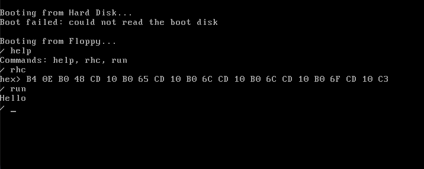
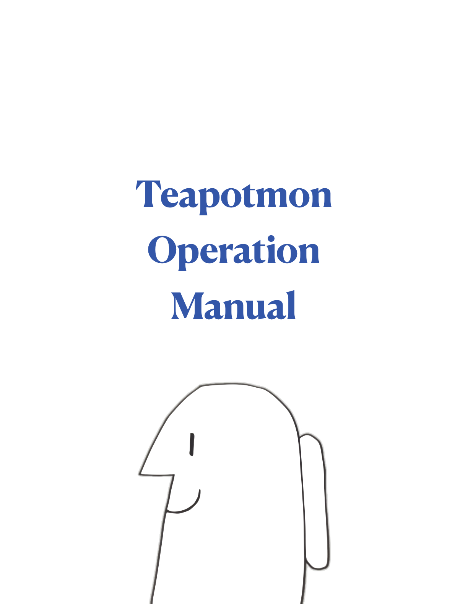
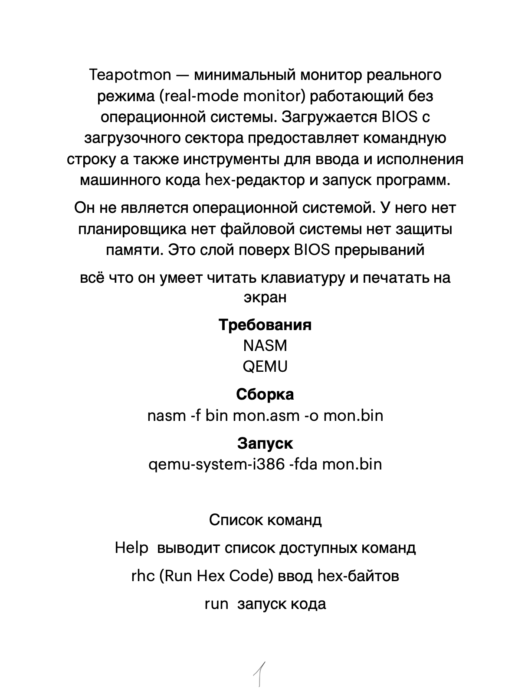
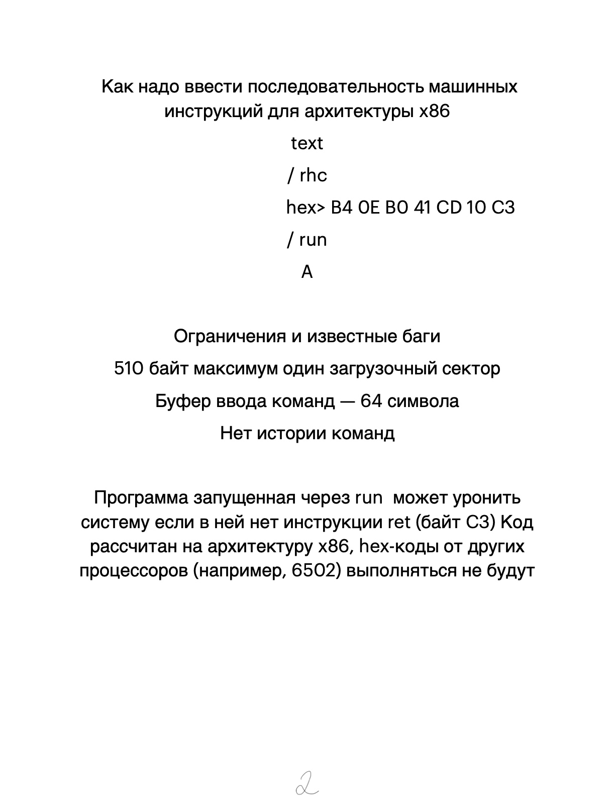
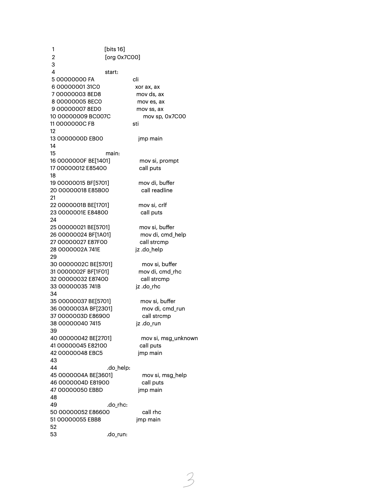
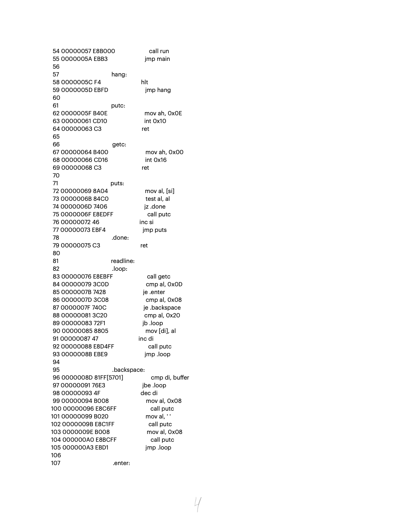
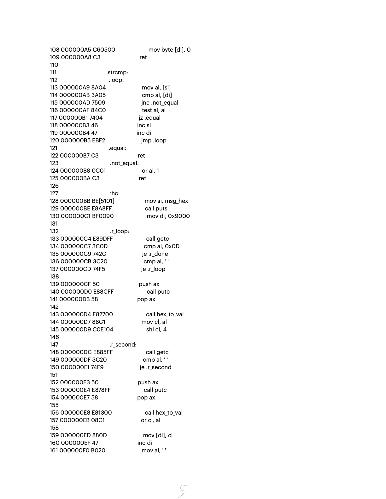
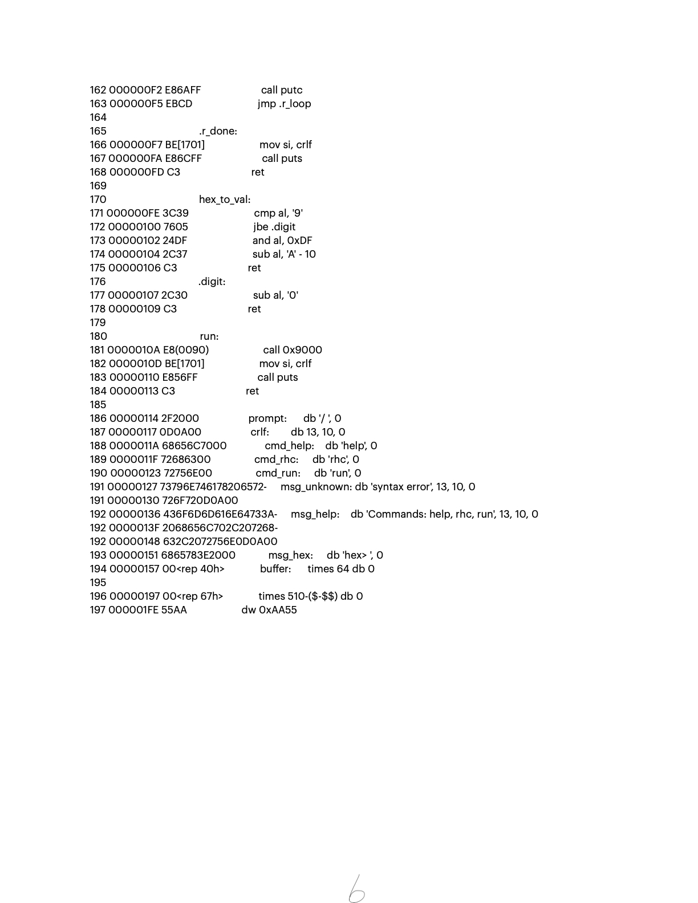

# Teapotmon

Минимальный монитор реального режима (real-mode monitor) для архитектуры x86. Работает без операционной системы.



## Возможности
* Командная строка.
* Ввод машинного кода в hex-формате (`rhc`).
* Запуск введенного кода (`run`).
* Умещается в 512 байт (один загрузочный сектор).

## Команды
* `help` — список команд.
* `rhc` — ввод hex-байтов по адресу `0x9000`.
* `run` — запуск кода из `0x9000`.

## Сборка и запуск
```bash
nasm -f bin mon.asm -o mon.img
qemu-system-i386 -fda mon.img


```







